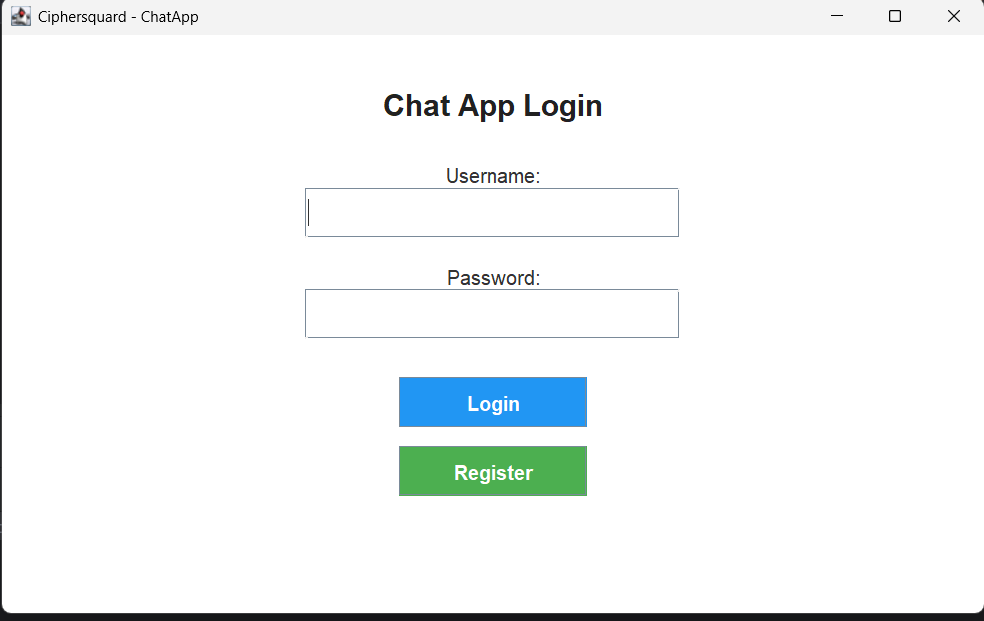

# ChatApp — Java RMI Chat Application

A multi-user, real-time chat application built with Java. It uses **Java RMI** for remote method invocation, **TCP sockets** for streaming messages, a **Swing GUI** for the desktop client, and **MySQL + Hibernate/JPA** for persistence.

[]

---

## Table of Contents

- [Features](#features)
- [Architecture Overview](#architecture-overview)
- [Technology Stack](#technology-stack)
- [Module Breakdown](#module-breakdown)
  - [Server](#server)
  - [Client](#client)
  - [Models](#models)
  - [Common Utilities](#common-utilities)
- [Database Schema](#database-schema)
- [Communication Flow](#communication-flow)
- [Prerequisites](#prerequisites)
- [Building & Running](#building--running)
- [Configuration](#configuration)
- [Project Structure](#project-structure)

---

## Features

- User registration and login with role-based access (Admin / Regular User)
- Admin can create and manage chat rooms, subscribe users, and start/stop sessions
- Real-time message broadcasting to all connected clients
- Join and leave notifications for all participants
- Persistent message history stored in MySQL and exported to log files
- User profile management including profile picture upload
- Admin user management panel (view, edit, remove users)

---

## Architecture Overview

```
┌────────────────────────────────────────────────────────────────┐
│                     CLIENT (Swing GUI)                         │
│                                                                │
│  AppScreen (CardLayout router)                                 │
│  ├── Login / Register screens  → UserService (DB auth)         │
│  ├── UserChatScreen            → ChatScreen (send/receive)     │
│  ├── AdminChatScreen           → Chat management               │
│  ├── AdminCreateNewChat        → Chat room creation            │
│  ├── AdminUserList             → User management               │
│  └── UserProfileScreen         → Profile editing               │
│                                                                │
│  ChatHandler (background thread)                               │
│  └── Socket → Server port 3001 (receives NetworkMessage)       │
└──────────────────────┬─────────────────────────────────────────┘
                       │  RMI (port 1099) + TCP Sockets (port 3001)
┌──────────────────────▼─────────────────────────────────────────┐
│                     SERVER                                     │
│                                                                │
│  RMI Registry (port 1099) exposes ServerInterface              │
│  Server (UnicastRemoteObject)                                  │
│  ├── ServerSocket (port 3001) → accepts client connections     │
│  ├── Maintains synchronized list of online UserClients         │
│  ├── Broadcasts NetworkMessage objects via ObjectOutputStream  │
│  └── Persists messages to MySQL via Hibernate                  │
└──────────────────────┬─────────────────────────────────────────┘
                       │  JDBC / JPA (Hibernate)
┌──────────────────────▼─────────────────────────────────────────┐
│                  MySQL Database (chat_application)             │
│                                                                │
│  users · chats · chat_messages · chat_files · user_chats       │
└────────────────────────────────────────────────────────────────┘
```

---

## Technology Stack

| Layer | Technology |
|---|---|
| Language | Java 23 |
| GUI | Java Swing |
| Remote Calls | Java RMI |
| Message Streaming | TCP Sockets + Java Object Serialization |
| ORM / Persistence | Hibernate 7 / JPA 3.2 |
| Database | MySQL 8.0 |
| JDBC Driver | mysql-connector-java 8.0.33 |
| XML Binding | JAXB Runtime 4.0.5 |
| Build Tool | Apache Maven (with Shade plugin for fat JAR) |
| Testing | JUnit Jupiter 5.11 |

---

## Module Breakdown

### Server

**Package:** `server`

| Class | Role |
|---|---|
| `Main` | Bootstraps the application: creates the RMI registry on port 1099, instantiates `Server`, and binds it under the name `"server"`. Also starts the socket listener on port 3001. |
| `ServerInterface` | `java.rmi.Remote` interface declaring all remotely invocable methods (`sendBroadcastMessage`, `addOnlineUser`, `sendUserJoinMessage`, `sendAdminStartChat`, `sendUserLeaveChat`, `listenForUsers`). |
| `Server` | Implements `ServerInterface`, extends `UnicastRemoteObject`. Maintains a synchronized list of connected `UserClient` objects, accepts incoming socket connections in a thread, broadcasts `NetworkMessage` objects to all clients, and persists chat messages to MySQL via Hibernate. Also writes chat transcripts to text-based log files. |

### Client

**Package:** `client`

| Class | Role |
|---|---|
| `Main` | Entry point — launches `AppScreen` on the Swing event dispatch thread. |
| `UserClient` | Serializable value object that the server uses to track connected clients. Holds user id and a transient `Socket` reference. |

**GUI — Common** (`client.gui.common`)

| Class | Role |
|---|---|
| `AppScreen` | Root `JFrame` (800 × 500) using `CardLayout` as the application router. Stores the currently authenticated `User` and switches between all named screens. |

**GUI — Shared** (`client.gui.shared`)

| Class | Role |
|---|---|
| `ChatArea` | Abstract base providing the chat panel, message input field, Send button, and a `ChatHandler` thread reference. Contains the core message-display logic used by all chat screens. |
| `ChatScreen` | Extends `ChatArea`. Adds a left-side chat list panel, handles chat selection, loads message history from the database, and shows only currently active chat rooms. |
| `Menu` | Base menu-bar class providing *Profile* and *Logout* items shared by both user and admin menus. |

**GUI — User screens** (`client.gui.user`)

| Class | Role |
|---|---|
| `UserLoginScreen` | Username/password form. Delegates authentication to `UserService` and routes to `UserChatScreen` or `AdminChatScreen` based on the `isAdmin` flag. |
| `UserRegisterScreen` | Registration form (email, username, nickname, password, profile picture). Persists new `User` via `UserService`. |
| `UserChatScreen` | Chat screen for regular users. Extends `ChatScreen`, attaches `UserMenu`. |
| `UserProfileScreen` | Allows the logged-in user to update email, username, nickname, password, and profile picture. |
| `UserMenu` | Navigation menu for regular users (Chat List, Profile, Exit). |
| `ChatHandler` | `Runnable` background thread that maintains the client's socket connection to the server, reads incoming `NetworkMessage` objects, and dispatches them by type: `CHAT` → display bubble, `JOIN_MESSAGE` / `LEAVE_MESSAGE` → status notifications, `CHAT_START` → load new chat room. |

**GUI — Admin screens** (`client.gui.admin`)

| Class | Role |
|---|---|
| `AdminChatScreen` | Chat screen for admins. Extends `ChatScreen`, attaches `AdminMenu`, and includes a *Start Chat* button. Checks whether a chat session is active before allowing message display. |
| `AdminCreateNewChat` | Form to create a new chat room: chat title, subscriber selection, and a file path for the chat transcript log. |
| `AdminUserList` | `JTable` listing all users (ID, email, username, nickname) with buttons to remove or edit a selected user. |
| `AdminMenu` | Navigation menu for admins (Chat List, Create New Chat, Manage Users, Profile, Exit). |

**GUI — Utilities** (`client.gui.utility`)

| Class | Role |
|---|---|
| `UserService` | JPA-backed service for `saveUser` (registration) and `userlogin` (authentication). |
| `JPAUtil` | Singleton that manages the `EntityManagerFactory` and `EntityManager` for the client-side JPA context. |
| `ChatUtility` | Renders message bubbles: formats profile pictures as rounded images, and exposes `displayUserMessage`, `displaySubscriberJoinMessage`, and `displaySubscriberLeaveMessage` helpers. |
| `ChatBubble` | Custom `JPanel` that renders a single chat message as a styled bubble — includes the sender's rounded profile picture, username, HTML-formatted message text, and timestamp. |

### Models

**Package:** `models` — JPA entities mapped to MySQL tables.

| Entity | Table | Key Fields |
|---|---|---|
| `User` | `users` | `id`, `email`, `username`, `password`, `nickName`, `profilePicturePath`, `isAdmin`, `createdAt`, `updatedAt` |
| `Chat` | `chats` | `id`, `title`, `admin` (FK → User), `startTime`, `endTime`, `isActive`, `createdAt` |
| `ChatMessage` | `chat_messages` | `id`, `chat` (FK), `user` (FK), `message` (LOB), `sentAt` |
| `ChatFile` | `chat_files` | `id`, `chat` (FK), `filePath`, `createdAt` |
| `UserChat` | `user_chats` | Composite key (`userId`, `chatId`), `subscribedAt`, `unsubscribedAt` |
| `UserChatId` | *(embeddable)* | Composite primary key for `UserChat` |

### Common Utilities

**Package:** `common`

| Class/Interface | Role |
|---|---|
| `HibernateUtil` | Singleton that creates and exposes the server-side `EntityManagerFactory` using the `"default"` persistence unit. |
| `MessageObserver` | Observer interface with a single `messageReceived(String message)` method, enabling decoupled message delivery. |
| `NetworkMessage` | Serializable DTO passed over sockets between server and clients. Contains `type` (enum), `message` (String), and optional `chatMessage`, `chat`, `user` payload fields. |
| `NetworkMessageType` | Enum of message event types: `CHAT`, `INFO_MESSAGE`, `JOIN_MESSAGE`, `CHAT_START`, `LEAVE_MESSAGE`. |

---

## Database Schema

```
users
  id (PK), email, username, password, nick_name,
  profile_picture_path, is_admin, created_at, updated_at

chats
  id (PK), title, admin_id (FK → users.id),
  start_time, end_time, is_active, created_at

chat_messages
  id (PK), chat_id (FK → chats.id), user_id (FK → users.id),
  message (TEXT/LOB), sent_at

chat_files
  id (PK), chat_id (FK → chats.id), file_path, created_at

user_chats
  user_id (FK → users.id), chat_id (FK → chats.id),   ← composite PK
  subscribed_at, unsubscribed_at
```

Hibernate is configured with `hbm2ddl.auto=update`, so all tables are created or migrated automatically on startup.

---

## Communication Flow

### Sending a Message

```
User types message
      │
      ▼
ChatScreen calls server.sendBroadcastMessage(ChatMessage)  [RMI]
      │
      ▼
Server.sendBroadcastMessage()
  ├── Saves ChatMessage to MySQL via Hibernate
  └── Iterates onlineUsers list → writes NetworkMessage{type=CHAT} to each Socket
            │
            ▼ (all clients)
  ChatHandler.run() reads NetworkMessage
            │
            ▼
  ChatUtility.displayUserMessage() → renders ChatBubble in chat panel
```

### User Join / Leave

```
Client connects to server socket (port 3001)
      │
      ▼
Client calls server.addOnlineUser(UserClient)         [RMI]
Client calls server.sendUserJoinMessage(username, chat) [RMI]
      │
      ▼
Server broadcasts NetworkMessage{type=JOIN_MESSAGE} to all clients
      │
      ▼
ChatHandler dispatches → status notification displayed in chat panel
```

### Admin Starts a Chat

```
Admin clicks "Start Chat"
      │
      ▼
AdminChatScreen calls server.sendAdminStartChat(chat)  [RMI]
      │
      ▼
Server broadcasts NetworkMessage{type=CHAT_START, chat=...} to all clients
      │
      ▼
ChatHandler dispatches → all clients load the new chat room
```

---

## Prerequisites

- **Java 23** JDK
- **Maven 3.8+**
- **MySQL 8.0** — create database `chat_application`

---

## Building & Running

```bash
# Build fat JAR
mvn clean package

# Run the server (start this first)
java -cp target/ChatApp-1.0-SNAPSHOT.jar server.Main

# Run the client (in a separate terminal)
java -cp target/ChatApp-1.0-SNAPSHOT.jar client.Main
```

For Windows, a native installer can be produced via the `jpackage` Maven plugin (requires `jpackage` on PATH):

```bash
mvn verify
# Installer generated at target/installer/
```

---

## Configuration

Database connection is defined in `src/main/resources/META-INF/persistence.xml`:

```xml
<property name="jakarta.persistence.jdbc.url"
          value="jdbc:mysql://localhost:3306/chat_application"/>
<property name="jakarta.persistence.jdbc.user" value="root"/>
<property name="jakarta.persistence.jdbc.password" value=""/>
```

Update the URL, username, and password to match your MySQL installation before building.

---

## Project Structure

```
ChatApp/
├── pom.xml
├── src/
│   └── main/
│       ├── java/
│       │   ├── client/
│       │   │   ├── Main.java
│       │   │   ├── UserClient.java
│       │   │   └── gui/
│       │   │       ├── common/        # AppScreen (root JFrame)
│       │   │       ├── shared/        # ChatArea, ChatScreen, Menu
│       │   │       ├── user/          # Login, Register, ChatScreen, Profile
│       │   │       │   └── common/    # UserMenu, ChatHandler
│       │   │       ├── admin/         # AdminChatScreen, NewChat, UserList
│       │   │       │   └── common/    # AdminMenu
│       │   │       └── utility/       # UserService, JPAUtil, ChatUtility, ChatBubble
│       │   ├── common/                # HibernateUtil, MessageObserver, NetworkMessage*
│       │   ├── models/                # User, Chat, ChatMessage, ChatFile, UserChat*
│       │   └── server/                # Main, ServerInterface, Server
│       └── resources/
│           ├── META-INF/
│           │   └── persistence.xml    # JPA / Hibernate configuration
│           └── no-profile.png         # Default profile picture
└── users.txt                          # Local user log (runtime generated)
```
